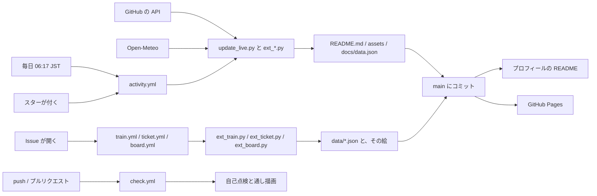

# この駅のしくみ

[プロフィール](https://github.com/takosasi-dev)の発車標や路線図が、どう作られて、どう動いているかの説明です。
同じ物を作りたい方、Issue で動く仕掛けの守り方を見たい方に向けて書いています。

## 何で出来ているか

- **Python の標準ライブラリだけ**です。毎日動くスクリプト(`scripts/`)は `pip install` を 1 つも必要としません。
  例外は、カードの写真を手で作るときだけ使う `scripts/make_poster.py`(Pillow)です。Actions では動きません。
- **絵は全部 SVG** で、スクリプトが文字列として書き出します。画像の生成サービスやバッジのサービスは使っていません。
- **LED の文字は、点を 1 つずつ SVG に描いています。** 字の形は東雲フォント(パブリックドメインのビットマップフォント、`scripts/fonts/`)から読みます。
  フォントファイルを読み込ませる形ではないので、見る人の端末に入っているフォントに関係なく同じ形で出ます。描くのは `scripts/led.py` です。
- **動きは SVG の中の CSS アニメーション**です。README では JavaScript が動かないので、流れる文字も、反転フラップも、列車も CSS だけで動かしています。
  押して遊ぶ物は `<details>` の開け閉めで作っています。
- **構内のページ([GitHub Pages](https://takosasi-dev.github.io/takosasi-dev/))は、素の HTML・CSS・JavaScript** です。フレームワークもビルドもありません。`docs/` をそのまま配っています。

外から読む物は、次の 3 つだけです。

| 読む先 | 読む物 | 読む場所 |
|---|---|---|
| GitHub の API | 公開リポジトリ・リリース・コントリビューション・スター・コミットの時刻 | Actions の中 |
| avatars.githubusercontent.com | スターを付けた方のアイコン(64px。絵の中に埋め込みます) | Actions の中 |
| Open-Meteo | 東京の今日の天気(場所は東京の中心に固定。鍵は不要) | Actions の中 |

構内のページがブラウザから読むのは、このサイト自身と、GitHub の公開 API(最近の push の一覧)だけです。
アクセス解析・広告・外部のフォントやスクリプトは、README にも構内のページにもありません。

## 動き方



| ファイル | 役目 |
|---|---|
| `scripts/update_live.py` | GitHub の API に依る物を全部作り直します。README の中の、印(`<!-- CARDS:START -->` など)で挟んだ所も書き換えます |
| `scripts/build_assets.py` | API に依らない絵(駅名標・路線図・ミニゲームの絵など)を作ります。手で実行します |
| `scripts/ext_*.py` | 絵 1 種類につき 1 ファイルの追加部品です。`static()` は `build_assets.py` から、`live(ctx)` は `update_live.py` から呼ばれます |
| `scripts/led.py`・`flap.py`・`style.py` | LED の文字、反転フラップ、共通の色と枠 |
| `data/*.json` | Issue で変わる状態(列車の位置・きっぷの番号・伝言板)。Actions だけが書きます |
| `docs/` | 構内のページ。`docs/data.json` と `docs/font.js` はスクリプトが作ります |

`update_live.py` は最後に、README が指している画像が全部あるか、公開リポジトリが全部一覧に載っているかを確かめます。
足りなければそこで止まり、コミットしません。壊れた README が公開される前に止めるためです。

リポジトリの分類は GitHub の topics で決めています。新しいリポジトリは、topics を付ければ次の更新で一覧に載ります。
制作物のカードは、topics に `featured` を付けたリポジトリです。

## 見知らぬ人の入力の受け方

列車・きっぷ・伝言板は、見に来た人が Issue を開くと動きます。つまり、誰でも Actions を起動でき、その結果が `main` にコミットされます。
ここがこのリポジトリでいちばん気を付けている所です。

**1. 受け取るのは、Issue の題名とアカウント名だけ。**
本文・ラベル・コメントは読みません。札のリンクが入れる本文も、案内の文として表示されるだけで、どこにも使いません。

**2. イベントの値を、スクリプトの文の中に書かない。**
workflow の `run:` に `${{ github.event.issue.title }}` を直接書くと、題名がシェルの文として実行されます。
値は必ず `env:` で環境変数に入れ、Python が `os.environ` から読みます。

```yaml
- name: Move the train
  env:
    TITLE: ${{ github.event.issue.title }}
    LOGIN: ${{ github.event.issue.user.login }}
  run: python3 scripts/ext_train.py move > "$RUNNER_TEMP/answer.txt"
```

**3. 形が完全に合った物だけ通す。**
題名は `re.fullmatch` で、決まった形(`train: 1`〜`train: 3`、`ticket`、`board: 1`〜`board: 8`)と前後まで一致するかを見ます。
アカウント名も `[A-Za-z0-9-]{1,39}` に一致する物だけです。きっぷではアカウント名がファイル名になるので、
Windows で取り出せない名前(`con`・`nul` など)も断ります。合わなければ状態は 1 文字も変わりません。

**4. 返事は決まった文。**
Issue への返事は、スクリプトの中に書いてある文から選びます。訪問者が打った文字を、そのまま返すことはありません。
きっぷの返事にだけ、検査を通ったあとのアカウント名(を小文字にした画像の URL)が入ります。
伝言板に書けるのも、用意した 8 つの文のどれかです。自由な文は書けません。

**5. 自分が書いた状態も、読むたびに検査する。**
`data/*.json` は Actions しか書きませんが、絵にする前にもう一度、同じ規則で検査し直します。
合わない行は捨てます。

**6. 権限は要る分だけ、Action は SHA で固定。**
各 workflow の `permissions:` は、使う物だけです(Issue に返事をしてコミットする物は `contents: write` と `issues: write`、毎日の更新は `contents: write` だけ、点検だけの `check.yml` は `contents: read`)。
使っている外の Action は `actions/checkout` だけで、タグではなくコミットの SHA で指定しています。

**7. 順番に 1 つずつ。**
列車・きっぷ・伝言板は、それぞれ `concurrency` で同時に 1 本しか走りません。きっぷの番号が重ならないようにするためです。
待っていた run は、始まるときに `main` の最新を取り直します(`actions/checkout` の `ref`)。Issue が開いた時点のコミットのままだと、
前の run が出した番号を知らずに、同じ番号を出してしまうからです。
題名が合わない Issue は別の組に入れて、順番待ちの席を取らせません(Issue が開くと、題名に関係なく全部の workflow が起動するため)。
ほかの workflow と push がぶつかったときは、`git pull --rebase` してやり直します(触るファイルが別なので、必ず当たります)。

**8. 緩めたら CI で落ちる。**
各スクリプトは、引数なしで実行すると自己点検をします。断るべき題名やアカウント名の例が入っていて、
検査を緩める変更をすると `check.yml` が失敗します。

知っている限界も書いておきます。GitHub の `concurrency` は、待ちの run を 1 本しか持ちません。
同じ数秒のうちに Issue が 3 つ以上開くと、間の Issue には返事が付かないことがあります。遊びの仕掛けなので、そのままにしています。

回数の上限も付けていません。決まりは「伝言板は 1 人 1 行」「列車は同じ人が続けて 2 回は運転できない」だけです。
上限を足しても、Issue が開くこと自体は止められないからです。荒らされたときは、その人を GitHub でブロックします。
ブロックされた人は Issue を開けなくなり、付けたスターも外れるので、乗客の列車からも次の更新で降ります。
スターを付けた方のアイコンは確かめずに載せているので、困る絵が載ったときも同じ手で外します。

構内のページは、`Content-Security-Policy` を `default-src 'none'` から始めて、自分のサイトのスクリプトと CSS だけを許しています。
枠(`frame-src`)も自分のサイトだけです。「駅前ライブカメラ」が、README と同じ駅前の絵(`docs/live.svg`)を枠に入れて、
空と灯りを見ている人の時計に合わせるために使います。
LED の文字はキャンバスに点で描き、それ以外の文は `textContent` で入れます。`innerHTML` は使っていないので、API から来た文字列が HTML として解釈される場所がありません。
スタンプラリーの記録は、見ている人のブラウザ(`localStorage`)にだけ残り、どこにも送りません。

## 見え方への配慮

- **画像には全部、代わりの文(alt)を付けています。** SVG の中にも同じ内容の `aria-label` があります。
- **OS の「動きを減らす」設定**(`prefers-reduced-motion`)にしていると、アニメーションは止まります。止まった絵でも内容が読めるようにしています。
- **ライトとダーク**のどちらでも読めます。LED の板は黒い箱なので、白い画面でもそのまま通ります。
  白い札は、ダークテーマでは紺色に変わります(SVG の中の `@media (prefers-color-scheme: dark)`)。
- **スマホ**では、LED の板はそのまま縮みます。字は 16 ドットを基本にして、縮んでも読める大きさにしています。
  字の細かい白い札(路線図・時刻表・沿革など)は、画面の幅が 600px 以下のときだけ、縦長に組み直した版に切り替えます(`<picture>` の `media`)。
- 色だけで伝えません。運行情報は色と一緒に「平常運転」「遅延」と文字で出します。

## 手元で動かす

Python 3 があれば動きます。

```sh
# 自己点検(各スクリプトを引数なしで)
for f in scripts/led.py scripts/flap.py scripts/ext_*.py; do python3 "$f"; done

# API に依らない絵
python3 scripts/build_assets.py

# API に依る物(GitHub のトークンが要ります)
GITHUB_TOKEN=$(gh auth token) python3 scripts/update_live.py

# API の答えを保存して、次からはネットワークなしで描く
PROFILE_SAVE=saved.json GITHUB_TOKEN=$(gh auth token) python3 scripts/update_live.py
python3 scripts/update_live.py saved.json

# 別の日の絵を見る(季節・記念日・日替わりの物)
PROFILE_DATE=2026-12-31 python3 scripts/update_live.py saved.json
```

どれも `README.md`・`assets/`・`docs/` をその場で書き換えます。試すときは、作業用の写しでどうぞ。

## まねして使うとき

コードは [MIT ライセンス](LICENSE)です。著作権表示とライセンスの文を残せば、自由に使えます。東雲フォントはパブリックドメインです(`scripts/fonts/README.txt`)。

- アカウント名は、スクリプトと構内のページに直接書いてあります(`update_live.py`・`ext_ticket.py`・`ext_stations.py` の `USER`、`docs/station.js` の `USER`、README の Issue のリンクなど)。`takosasi-dev` で検索して、全部を自分の名前に変えてください。
- `data/*.json` と `tickets/` は、この駅の記録です。空にしてから始めてください。
- `assets/posters/` の画像は作者の制作物の画面写真、乗客の列車の絵に入るアイコンはスターを付けた方の物です。持って行かないでください。
- Issue で動く workflow を写すときは、上の「見知らぬ人の入力の受け方」の 1〜6 を崩さないでください。とくに 2 は、1 行直すだけで穴になります。
- GitHub Pages は、リポジトリの設定で「`main` ブランチの `/docs`」を選びます。

なお、この駅には、案内に載せていない物がいくつかあります。探してみてください。

---

## In English (short)

This repository is a GitHub profile README dressed as a Japanese railway station.

- **Standard-library Python only.** The scripts in `scripts/` write every picture as SVG text; nothing is installed in CI. The LED text is drawn dot by dot from the public-domain Shinonome bitmap fonts, so it does not depend on the viewer's fonts. All motion is CSS inside the SVGs, because a README runs no JavaScript.
- **Rebuilt by GitHub Actions** once a day, and when someone stars the repository. `update_live.py` reads the GitHub API (and today's weather in Tokyo from Open-Meteo), redraws the panels, rewrites the marked parts of `README.md`, and refuses to commit if the README would point at a missing file.
- **Visitors can change things by opening an issue** (move the train, get a ticket, write on the message board). Only the issue title and the login are read. They reach Python through `env:` and never appear inside a `run:` script; they must match exact patterns with `re.fullmatch`; the reply is a fixed sentence; the body is never read; permissions are minimal; the only third-party action is pinned to a commit SHA; and the self-checks in CI fail if the validation is loosened.
- **No analytics, no ads, no external fonts or scripts.** The GitHub Pages site in `docs/` is plain HTML, CSS and JavaScript under a strict Content-Security-Policy.
- **Accessibility:** every image has alt text, animations stop under `prefers-reduced-motion`, and the pictures work in light and dark themes.
- Code: MIT. Fonts: public domain. If you reuse it, replace the account name everywhere, empty `data/` and `tickets/`, and do not copy the project screenshots or other people's avatars.
