


<a href="README.md">日本語</a> ・ <b>English</b>

<a href="https://x.com/kou111011051">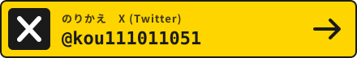</a>

I'm takosasi-dev. My field is infrastructure, networks and security (Windows Server, VMware, Linux, AWS, ModSecurity, Snort).
Here I publish what I build: games, desktop tools, Obsidian plugins, Chrome extensions and Minecraft Bedrock add-ons.

This profile is drawn as a Japanese railway station. The pictures are SVG files made by scripts in this repository, and a GitHub Actions workflow rebuilds them from the GitHub API every morning. The text inside the pictures is Japanese; this page says in English what each one shows. Most of my repositories are documented in Japanese.

<picture><source media="(prefers-color-scheme: dark)" srcset="assets/diorama-dark.svg"></picture>

**The station front.** One day passes in 60 seconds. Each building is one week of the past year, and its height is how much I did that week. It rains or snows on the screen when it does in Tokyo.

## Platform 2: Projects

<!-- The cards are the repositories with the topic "featured". Generated by scripts/update_live.py. -->
<!-- CARDS:START -->
<a href="https://github.com/takosasi-dev/kanade-daw">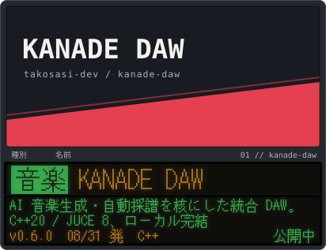</a>
<a href="https://github.com/takosasi-dev/koe-loom"></a>
<a href="https://github.com/takosasi-dev/rail-rampage"></a>
<a href="https://github.com/takosasi-dev/packet-bouncer">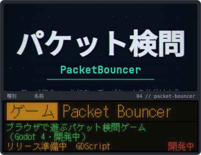</a>
<a href="https://github.com/takosasi-dev/padlab">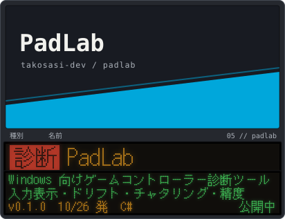</a>
<a href="https://github.com/takosasi-dev/net-diag">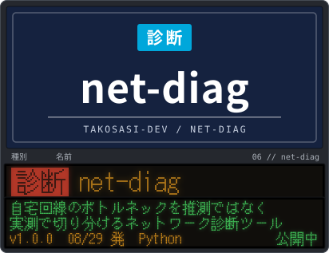</a>
<!-- CARDS:END -->

<a href="https://takosasi-dev.github.io/packet-bouncer/">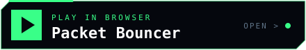</a>

| Project | What it is |
|---|---|
| [KANADE DAW](https://github.com/takosasi-dev/kanade-daw) | A DAW built around AI music generation and automatic transcription. C++20 / JUCE 8, runs locally |
| [KoeLoom](https://github.com/takosasi-dev/koe-loom) | A voice changer for Windows 11 (Discord and others). DSP only, JUCE / C++ |
| [RailRampage](https://github.com/takosasi-dev/rail-rampage) | A one-button side-scrolling game about the trolley problem (Godot 4) |
| [Packet Bouncer](https://github.com/takosasi-dev/packet-bouncer) | A browser game where you are the firewall (Godot 4, in development) |
| [PadLab](https://github.com/takosasi-dev/padlab) | A game controller diagnostic tool for Windows: input view, drift, chatter, accuracy |
| [net-diag](https://github.com/takosasi-dev/net-diag) | Finds the bottleneck of a home network by measuring instead of guessing |

The full list of public repositories, grouped by kind, is in the [Japanese page](README.md).

<picture><source media="(max-width: 600px)" srcset="assets/map-all-m.svg">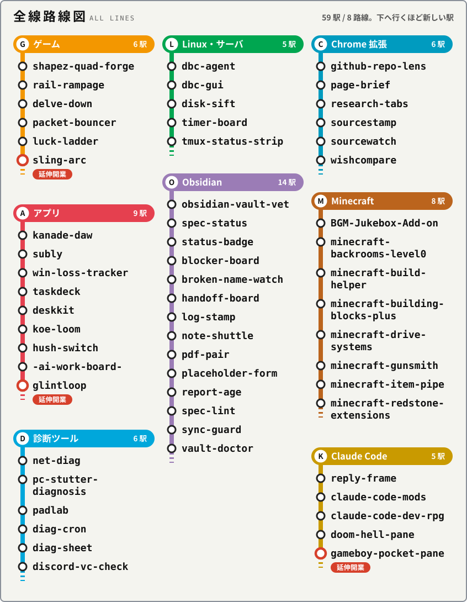</picture>
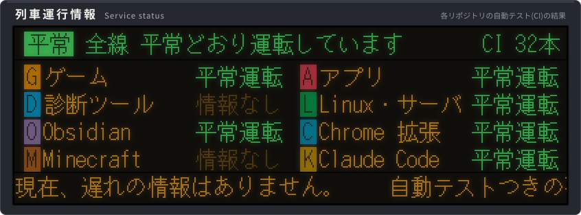
<picture><source media="(max-width: 600px)" srcset="assets/works-m.svg">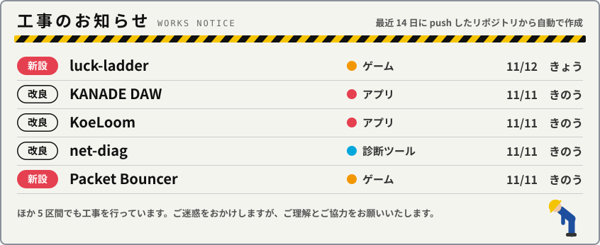</picture>

**Route map and service status.** Every category is a railway line and every repository a station. The status board reads the CI result of each repository: 平常運転 is "running normally", 遅延 is "delayed" (a failing test), 情報なし is "no information" (no CI). The works notice (工事のお知らせ) under it lists what is being worked on now: 新設 is a new repository, 改良 an improvement to an older one, きょう is today and きのう yesterday.

## Platform 3: Skills

<picture><source media="(max-width: 600px)" srcset="assets/routemap-m.svg">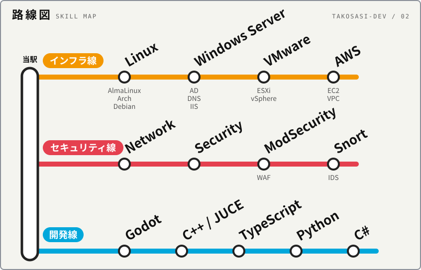</picture>
<picture><source media="(max-width: 600px)" srcset="assets/depot-m.svg"></picture>

## Platform 4: Activity

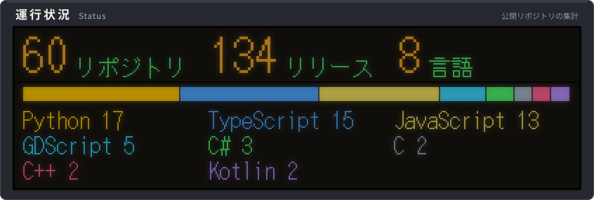
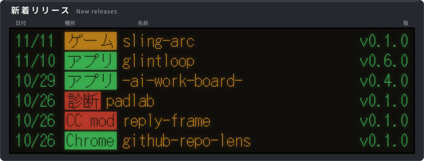
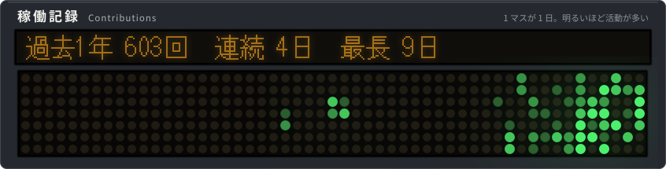
<picture><source media="(max-width: 600px)" srcset="assets/timetable-m.svg">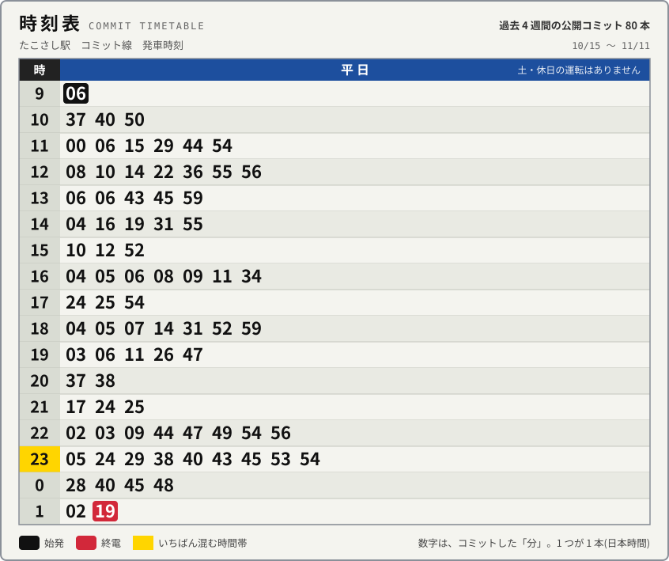</picture>
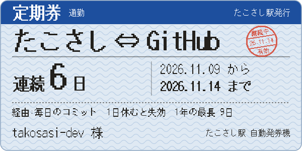
<picture><source media="(max-width: 600px)" srcset="assets/history-m.svg">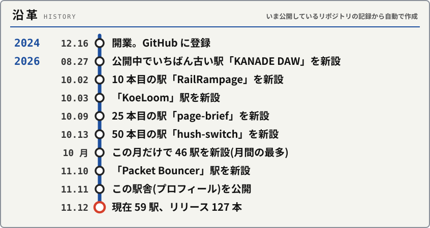</picture>

**The timetable is real.** Each number is the minute of a public commit of the last four weeks, in Japan time, with weekdays on the left and weekends on the right. The commuter pass is valid for as long as my current streak lasts and expires after one day off.

## Platform 5: Waiting room

Things a visitor can do. Each of them opens a pre-filled issue; press the green button without changing the title and a workflow answers and closes it. They need a GitHub login.

| | What happens |
|---|---|
| [Move the train](https://github.com/takosasi-dev/takosasi-dev/issues/new?title=train%3A%201) | Everyone moves one train around a loop line. This link moves it one station (`train: 2` and `train: 3` also work) |
| [Get a ticket](https://github.com/takosasi-dev/takosasi-dev/issues/new?title=ticket) | A commemorative ticket from this station to your account, with a serial number, as an image you can put in your own README |
| [Write on the message board](https://github.com/takosasi-dev/takosasi-dev/issues/new?title=board%3A%208) | Leaves "Hello from overseas" next to your name. `board: 1` to `board: 7` are Japanese lines such as "I came to have a look" |
| Star this repository | Your avatar appears in a window of the passengers' train within a few minutes |

<picture><source media="(max-width: 600px)" srcset="assets/train-m.svg">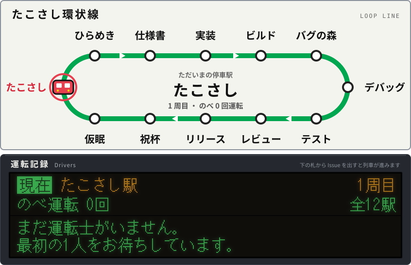</picture>

The mini games (a firewall quiz, reading attacks out of access logs, a subnet question that changes daily and more) are in the [Japanese page](README.md#noriba-5). Beyond the ticket gate, the [station on GitHub Pages](https://takosasi-dev.github.io/takosasi-dev/) has a departure board running on your clock, a departure bell, two keyboard games and a stamp rally.

<a href="https://takosasi-dev.github.io/takosasi-dev/kisaragi/">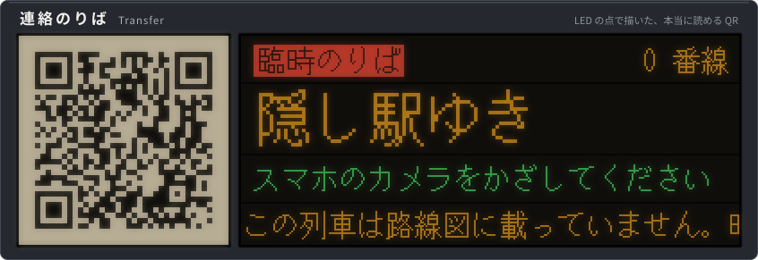</a>


<a href="ABOUT.md">How this station works</a> (in Japanese, with a short English summary)

