<b>ARCHIVE 01 // GAMES</b>

 

| Repo | 内容 |
|---|---|
| [packet-bouncer](https://github.com/takosasi-dev/packet-bouncer) | ブラウザで遊ぶパケット検問ゲーム（Godot 4・開発中） |
| [rail-rampage](https://github.com/takosasi-dev/rail-rampage) | トロッコ問題を題材にした横スクロールの1ボタン破壊ゲーム（Godot 4） |
| [delve-down](https://github.com/takosasi-dev/delve-down) | ターミナルで遊ぶ、文字で描くダンジョンのローグライク |
| [shapez-quad-forge](https://github.com/takosasi-dev/shapez-quad-forge) | shapez.io の目標シェイプから建物数最小の構築手順を逆算するツール |

<b>ARCHIVE 02 // DESKTOP TOOLS</b>

 

| Repo | 内容 |
|---|---|
| [kanade-daw](https://github.com/takosasi-dev/kanade-daw) | AI 音楽生成・自動採譜を核にした統合 DAW（C++20 / JUCE 8） |
| [koe-loom](https://github.com/takosasi-dev/koe-loom) | Windows 11 向けボイスチェンジャー（DSP のみ、JUCE / C++） |
| [padlab](https://github.com/takosasi-dev/padlab) | ゲームコントローラー診断ツール |
| [glintloop](https://github.com/takosasi-dev/glintloop) | 画像にエフェクトを重ねて短いループアニメーションを作る Windows アプリ |
| [deskkit](https://github.com/takosasi-dev/deskkit) | Windows 用 QOL ツールキットを1つの常駐アプリに |
| [subly](https://github.com/takosasi-dev/subly) | Android・Windows 両対応のサブスクリプション管理アプリ |
| [net-diag](https://github.com/takosasi-dev/net-diag) | 自宅回線のボトルネックを実測で切り分けるネットワーク診断ツール |
| [pc-stutter-diagnosis](https://github.com/takosasi-dev/pc-stutter-diagnosis) | PC のカクつきを実測で切り分ける診断ツール |

<b>ARCHIVE 03 // LINUX / SERVER</b>

 

| Repo | 内容 |
|---|---|
| [dbc-agent](https://github.com/takosasi-dev/dbc-agent) | systemd unit 単位の負荷と待たされ率（PSI）を集める常駐エージェント |
| [dbc-gui](https://github.com/takosasi-dev/dbc-gui) | SSH トンネル越しに Linux サーバの unit 単位の負荷を見る PC 側 GUI |
| [disk-sift](https://github.com/takosasi-dev/disk-sift) | 何がディスクを食っているかを原因別に出して安全に掃除する TUI/CLI |
| [timer-board](https://github.com/takosasi-dev/timer-board) | systemd タイマーの次回・前回・成否を一覧にする TUI/CLI |
| [tmux-status-strip](https://github.com/takosasi-dev/tmux-status-strip) | tmux のステータスバーに CPU・メモリ・CI・天気などを出すコマンド |
| [diag-cron](https://github.com/takosasi-dev/diag-cron) | 診断ツールを定期実行して結果を測定条件つきで残し、差分を取る |
| [diag-sheet](https://github.com/takosasi-dev/diag-sheet) | 診断ツールの結果 JSON を共通のシート形式に変換する |

<b>ARCHIVE 04 // OBSIDIAN PLUGINS</b>

 

| Repo | 内容 |
|---|---|
| [vault-doctor](https://github.com/takosasi-dev/vault-doctor) | リンク切れ・孤立ノート・命名や配置ルール違反を見つける |
| [sync-guard](https://github.com/takosasi-dev/sync-guard) | 同期や外部編集でノートが急に減ったときに警告する |
| [pdf-pair](https://github.com/takosasi-dev/pdf-pair) | 元の Markdown より古い PDF を見つける |
| [note-shuttle](https://github.com/takosasi-dev/note-shuttle) | 選んだノートを秘密情報をマスクして1つにまとめ、コピーする |
| [broken-name-watch](https://github.com/takosasi-dev/broken-name-watch) | 見えない文字や Windows で使えない文字を含む名前を警告する |
| [blocker-board](https://github.com/takosasi-dev/blocker-board) | 仕様ノートの未記入プレースホルダと、止めているフェーズを一覧にする |
| [handoff-board](https://github.com/takosasi-dev/handoff-board) | 引き継ぎノートを古い順にサイドバーへ並べる |
| [obsidian-vault-vet](https://github.com/takosasi-dev/obsidian-vault-vet) | vault を読むだけで点検する CLI |

<b>ARCHIVE 05 // CHROME EXTENSIONS</b>

 

| Repo | 内容 |
|---|---|
| [github-repo-lens](https://github.com/takosasi-dev/github-repo-lens) | リポジトリの事実を出典つきでコピーし、公開リポジトリを点検する |
| [sourcestamp](https://github.com/takosasi-dev/sourcestamp) | 開いているページの出典を Markdown の1行でコピーする |
| [research-tabs](https://github.com/takosasi-dev/research-tabs) | 調べ物で開いたタブを出典の一覧にまとめる |
| [page-brief](https://github.com/takosasi-dev/page-brief) | Chrome の端末内 AI でページを要約し、出典行つきでコピーする |
| [sourcewatch](https://github.com/takosasi-dev/sourcewatch) | 引用した出典のページが変わったかを知らせる |
| [wishcompare](https://github.com/takosasi-dev/wishcompare) | 迷っている商品を取り込み、価格を記録日つきで比べる |

<b>ARCHIVE 06 // MINECRAFT ADD-ONS / CLAUDE CODE MODS</b>

 

**Minecraft (Bedrock)** :
[BGM-Jukebox-Add-on](https://github.com/takosasi-dev/BGM-Jukebox-Add-on) /
[minecraft-item-pipe](https://github.com/takosasi-dev/minecraft-item-pipe) /
[minecraft-build-helper](https://github.com/takosasi-dev/minecraft-build-helper) /
[minecraft-building-blocks-plus](https://github.com/takosasi-dev/minecraft-building-blocks-plus) /
[minecraft-redstone-extensions](https://github.com/takosasi-dev/minecraft-redstone-extensions) /
[minecraft-drive-systems](https://github.com/takosasi-dev/minecraft-drive-systems) /
[minecraft-backrooms-level0](https://github.com/takosasi-dev/minecraft-backrooms-level0) /
[minecraft-gunsmith](https://github.com/takosasi-dev/minecraft-gunsmith)

**Claude Code** :
[reply-frame](https://github.com/takosasi-dev/reply-frame) /
[claude-code-mods](https://github.com/takosasi-dev/claude-code-mods) /
[claude-code-dev-rpg](https://github.com/takosasi-dev/claude-code-dev-rpg) /
[gameboy-pocket-pane](https://github.com/takosasi-dev/gameboy-pocket-pane) /
[doom-hell-pane](https://github.com/takosasi-dev/doom-hell-pane)

