

<picture><source media="(prefers-color-scheme: dark)" srcset="assets/diorama-dark.svg"></picture>

<a href="README.en.md">English version</a>

English (short)

 

I'm takosasi-dev. My field is infrastructure, networks and security (Windows Server, VMware, Linux, AWS, ModSecurity, Snort). 
Here I publish what I build: games, desktop tools, Obsidian plugins, Chrome extensions and Minecraft Bedrock add-ons. 
Most of the repositories are documented in Japanese. The numbers and lists on this page are rebuilt from the GitHub API once a day. 
The whole page in English: <a href="README.en.md">README.en.md</a>

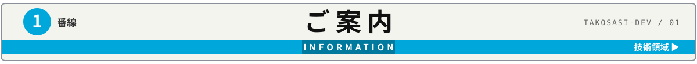
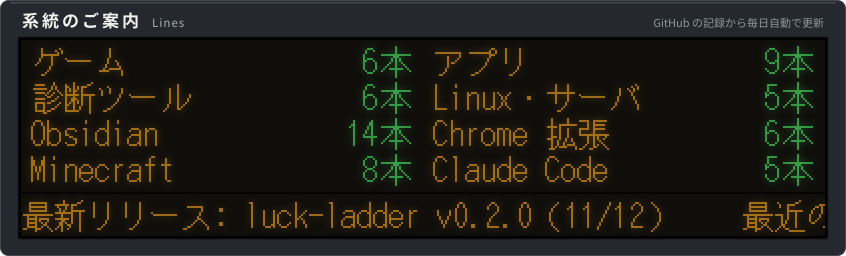
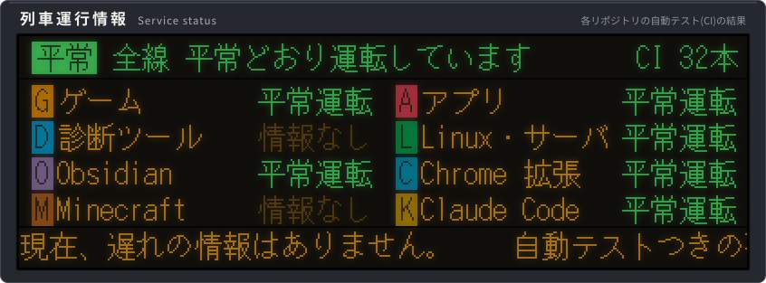

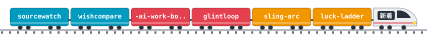

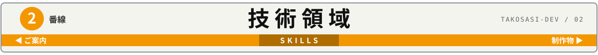

<!-- The cards are the repositories with the topic "featured". Generated by scripts/update_live.py. -->
<!-- CARDS:START -->
<a href="https://github.com/takosasi-dev/kanade-daw">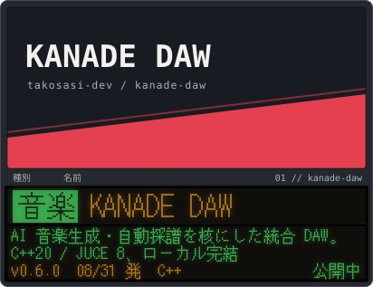</a>
<a href="https://github.com/takosasi-dev/koe-loom"></a>
<a href="https://github.com/takosasi-dev/rail-rampage"></a>
<a href="https://github.com/takosasi-dev/packet-bouncer">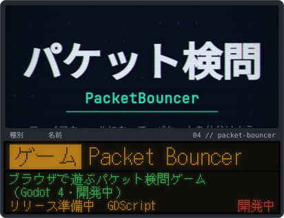</a>
<a href="https://github.com/takosasi-dev/padlab">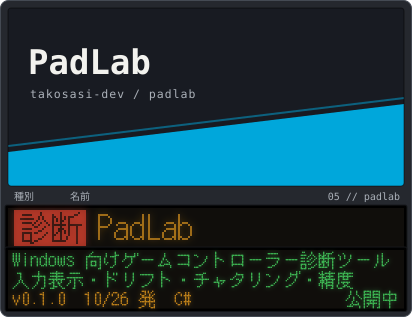</a>
<a href="https://github.com/takosasi-dev/net-diag">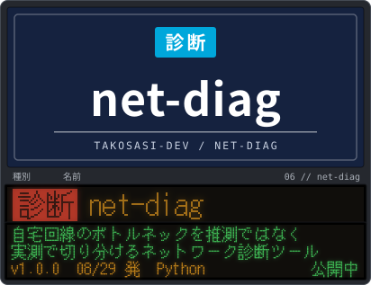</a>
<!-- CARDS:END -->

<picture><source media="(max-width: 600px)" srcset="assets/map-all-m.svg">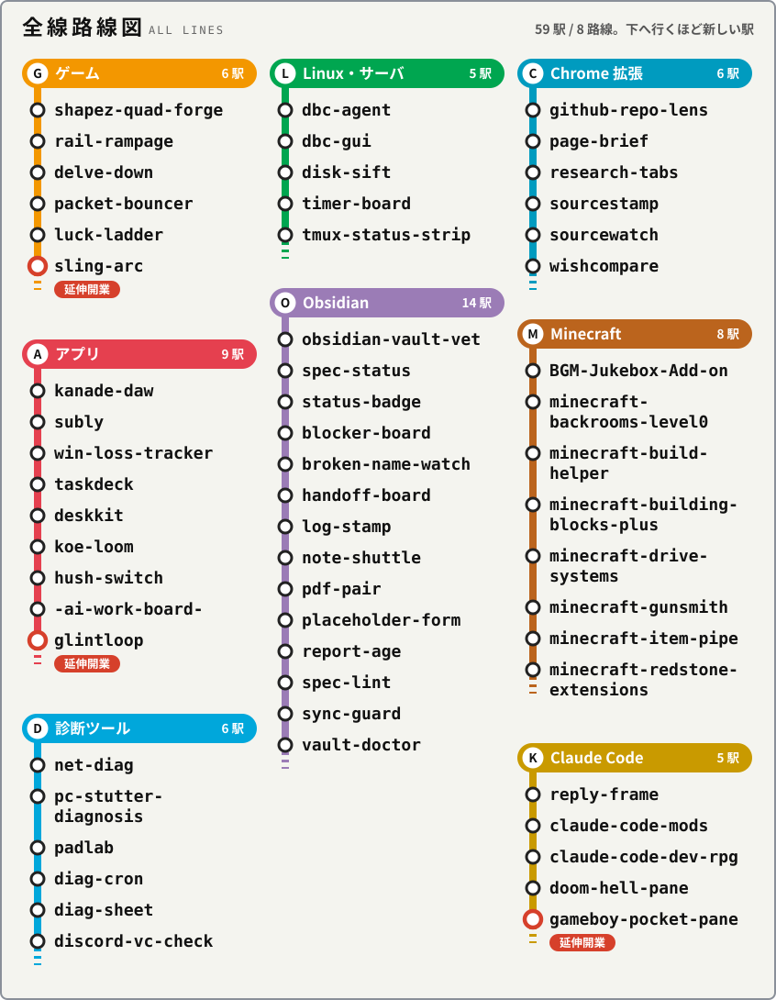</picture>

<!-- The list below is generated from the GitHub API by scripts/update_live.py. Do not edit it by hand. -->
<!-- ARCHIVE:START -->

<picture></picture>

 

| Repo | 内容 | Lang | Release |
|---|---|---|---|
| [delve-down](https://github.com/takosasi-dev/delve-down) | ターミナルで遊ぶ、文字で描くダンジョンのローグライク(Python 標準ライブラリだけ) | Python | v0.1.0 |
| [luck-ladder](https://github.com/takosasi-dev/luck-ladder) | ブラウザで遊べるトランプのハイ&ロー(Godot 4.7.2 / Web) | GDScript | v0.2.0 |
| [packet-bouncer](https://github.com/takosasi-dev/packet-bouncer) | ブラウザで遊ぶパケット検問ゲーム(Godot 4.7・開発中) | GDScript | - |
| [rail-rampage](https://github.com/takosasi-dev/rail-rampage) | トロッコ問題を題材にした横スクロールの1ボタン破壊ゲーム（Godot 4） | GDScript | v0.1.0 |
| [shapez-quad-forge](https://github.com/takosasi-dev/shapez-quad-forge) | shapez.io の目標シェイプから建物数最小の構築手順を逆算するツール (QuadForge) | Python | v0.2.0 |
| [sling-arc](https://github.com/takosasi-dev/sling-arc) | 惑星の重力で軌道を曲げてゴールに入れる、ブラウザで遊ぶ 2D ゲーム(Godot 4.7) | GDScript | v0.1.0 |

<picture></picture>

 

| Repo | 内容 | Lang | Release |
|---|---|---|---|
| [-ai-work-board-](https://github.com/takosasi-dev/-ai-work-board-) | 各 AI との作業の進み具合を1枚の画面で見て書けるボード | Python | v0.4.0 |
| [deskkit](https://github.com/takosasi-dev/deskkit) | Windows 用 QOL ツールキット(ModeShift / DropSort / LayoutKeep / ClipShelf)を1つの常駐アプリに | Python | v0.4.1 |
| [glintloop](https://github.com/takosasi-dev/glintloop) | 画像にエフェクトを重ねて短いループ アニメーション(GIF・APNG・WebP)を作る Windows アプリ | - | v0.6.0 |
| [hush-switch](https://github.com/takosasi-dev/hush-switch) | 指定したアプリの音だけをボタン1つでミュート/解除する Windows 用ソフト (C# / WPF / Core Audio) | C# | v0.3.0 |
| [kanade-daw](https://github.com/takosasi-dev/kanade-daw) | AI 音楽生成・自動採譜を核にした統合 DAW(C++20 / JUCE 8、ローカル完結) | C++ | v0.6.0 |
| [koe-loom](https://github.com/takosasi-dev/koe-loom) | Discord などで使える Windows 11 向けボイスチェンジャー（DSP のみ、JUCE / C++）。プレリリース | C++ | v0.6.0 |
| [subly](https://github.com/takosasi-dev/subly) | Subly - Android・Windows(PC)両対応のサブスクリプション管理アプリ | Kotlin | v0.1.4 |
| [taskdeck](https://github.com/takosasi-dev/taskdeck) | Windows 常駐の Todo アプリ。どこからでも Ctrl+Shift+Space で1行入力 | C# | v0.1.1 |
| [win-loss-tracker](https://github.com/takosasi-dev/win-loss-tracker) | 遊技の収支をオフラインで記録・集計する Android アプリ(INTERNET 権限なし) | Kotlin | v1.5.0 |

<picture></picture>

 

| Repo | 内容 | Lang | Release |
|---|---|---|---|
| [diag-cron](https://github.com/takosasi-dev/diag-cron) | 診断ツールを定期実行して結果を測定条件つきで残し、差分を取る | Python | v0.2.0 |
| [diag-sheet](https://github.com/takosasi-dev/diag-sheet) | 診断ツールの結果 JSON を共通のシート形式に変換する | Python | v0.2.0 |
| [discord-vc-check](https://github.com/takosasi-dev/discord-vc-check) | Discord の通話音声の不調を、マイク・スピーカー・回線・PC 負荷の区間ごとに切り分ける(非公式) | Python | v0.2.0 |
| [net-diag](https://github.com/takosasi-dev/net-diag) | 自宅回線のボトルネックを推測ではなく実測で切り分けるネットワーク診断ツール(CLI + GUI、Windows) | Python | v1.0.0 |
| [padlab](https://github.com/takosasi-dev/padlab) | Windows 向けゲームコントローラー診断ツール。入力の可視化・ドリフト・チャタリング・精度テスト | C# | v0.1.0 |
| [pc-stutter-diagnosis](https://github.com/takosasi-dev/pc-stutter-diagnosis) | PC のカクつき（遅延）を推測ではなく実測で切り分ける診断ツール | Python | v1.0.0 |

<picture></picture>

 

| Repo | 内容 | Lang | Release |
|---|---|---|---|
| [dbc-agent](https://github.com/takosasi-dev/dbc-agent) | Linux サーバの systemd unit 単位の負荷と待たされ率(PSI)を集める常駐エージェント。DBC のサーバ側 | Python | - |
| [dbc-gui](https://github.com/takosasi-dev/dbc-gui) | DBC の PC 側。SSH トンネル越しに Linux サーバの systemd unit 単位の負荷を見る | Python | - |
| [disk-sift](https://github.com/takosasi-dev/disk-sift) | 何がディスクを食っているかを原因別に出して安全に掃除する TUI/CLI(Arch Linux 向け) | Python | v0.1.0 |
| [timer-board](https://github.com/takosasi-dev/timer-board) | systemd タイマーの次回・前回・成否を一覧にする TUI/CLI(読むだけ) | Python | v0.1.0 |
| [tmux-status-strip](https://github.com/takosasi-dev/tmux-status-strip) | tmux のステータスバーに CPU・メモリ・CI・天気などを出すコマンド | Python | v0.1.0 |

<picture></picture>

 

| Repo | 内容 | Lang | Release |
|---|---|---|---|
| [blocker-board](https://github.com/takosasi-dev/blocker-board) | 仕様ノートの未記入プレースホルダと、止めているフェーズを一覧にする | TypeScript | 0.1.1 |
| [broken-name-watch](https://github.com/takosasi-dev/broken-name-watch) | 見えない文字や Windows で使えない文字を含む名前を警告する | TypeScript | 0.1.0 |
| [handoff-board](https://github.com/takosasi-dev/handoff-board) | 引き継ぎノートを古い順にサイドバーへ並べる | TypeScript | 0.1.1 |
| [log-stamp](https://github.com/takosasi-dev/log-stamp) | 日ごとの開発ログに時刻つきの記録を足す | TypeScript | 0.1.1 |
| [note-shuttle](https://github.com/takosasi-dev/note-shuttle) | 選んだノートを秘密情報をマスクして1つにまとめ、コピーする | TypeScript | 0.1.0 |
| [obsidian-vault-vet](https://github.com/takosasi-dev/obsidian-vault-vet) | Obsidian の vault を読むだけで点検する CLI(リンク切れ・孤立ノートなど6種) | Python | v0.1.0 |
| [pdf-pair](https://github.com/takosasi-dev/pdf-pair) | 元の Markdown より古い PDF を見つける | TypeScript | 0.1.0 |
| [placeholder-form](https://github.com/takosasi-dev/placeholder-form) | 仕様ノートの未記入プレースホルダをフォームで埋める(確認・バックアップ・取り消しつき) | TypeScript | 0.1.1 |
| [report-age](https://github.com/takosasi-dev/report-age) | 調査ノートがいつ書かれたか、どれだけ古いか、調べ直しが要るかを表示する | TypeScript | 0.1.1 |
| [spec-lint](https://github.com/takosasi-dev/spec-lint) | 開いている仕様ノートを、ルールノートの決まりと照らして点検する | TypeScript | 0.1.1 |
| [spec-status](https://github.com/takosasi-dev/spec-status) | Obsidian の仕様書がどこまで実装されたかを1か所で見る道具(一覧ノート・GUI・JSON。Python 標準ライブラリだけ) | Python | v0.7.1 |
| [status-badge](https://github.com/takosasi-dev/status-badge) | 開いているノートの実装状況を、見出し部のバッジで表示する | TypeScript | 0.3.0 |
| [sync-guard](https://github.com/takosasi-dev/sync-guard) | 同期や外部編集でノートが急に減ったときに警告する | TypeScript | 0.1.0 |
| [vault-doctor](https://github.com/takosasi-dev/vault-doctor) | リンク切れ・孤立ノート・命名や配置ルール違反を見つける | TypeScript | 0.1.0 |

<picture></picture>

 

| Repo | 内容 | Lang | Release |
|---|---|---|---|
| [github-repo-lens](https://github.com/takosasi-dev/github-repo-lens) | GitHub のリポジトリの事実を出典つきでコピーし、自分の公開リポジトリをルールと Actions の書き方で点検する Chrome 拡張(非公式) | JavaScript | v0.1.0 |
| [page-brief](https://github.com/takosasi-dev/page-brief) | Chrome の端末内 AI でページを要約し、出典行つきの Markdown でコピーする拡張 | JavaScript | v0.1.0 |
| [research-tabs](https://github.com/takosasi-dev/research-tabs) | 調べ物で開いたタブを出典の一覧(Markdown)にまとめ、コピーや Obsidian のノートにする Chrome 拡張 | JavaScript | v0.1.0 |
| [sourcestamp](https://github.com/takosasi-dev/sourcestamp) | 今開いているページの出典を Markdown の1行でコピーする Chrome 拡張(通信なし) | JavaScript | v0.1.0 |
| [sourcewatch](https://github.com/takosasi-dev/sourcewatch) | 調査レポートで引いた出典のページが前と変わったかを知らせる Chrome 拡張(通信なし) | JavaScript | v0.1.0 |
| [wishcompare](https://github.com/takosasi-dev/wishcompare) | 買うか迷っている商品を取り込み、価格を記録日つきで並べて比べる Chrome 拡張 | JavaScript | v0.1.0 |

<picture></picture>

 

| Repo | 内容 | Lang | Release |
|---|---|---|---|
| [BGM-Jukebox-Add-on](https://github.com/takosasi-dev/BGM-Jukebox-Add-on) | Minecraft 統合版の BGM ジュークボックスアドオンと、好きな音楽から .mcaddon を作る生成ツール(Windows / Android)(非公式) | JavaScript | v0.2.0 |
| [minecraft-backrooms-level0](https://github.com/takosasi-dev/minecraft-backrooms-level0) | Minecraft統合版アドオン。The Backrooms の Level 0 を専用ディメンションに無限生成(非公式) | JavaScript | v0.5.0 |
| [minecraft-build-helper](https://github.com/takosasi-dev/minecraft-build-helper) | Minecraft統合版の協力建築支援。設計図・ゴースト表示・ミラー設置・集合TP | JavaScript | v1.1.0 |
| [minecraft-building-blocks-plus](https://github.com/takosasi-dev/minecraft-building-blocks-plus) | Minecraft 統合版に縦ハーフ・階段・アーチなど 5,740 種の形状ブロックを足すアドオン(非公式) | Python | v1.5.0 |
| [minecraft-drive-systems](https://github.com/takosasi-dev/minecraft-drive-systems) | Minecraft統合版アドオン。門・扉・エレベーター・ベルトなどの駆動系機構と建材・標識・看板(非公式) | JavaScript | v2.7.2 |
| [minecraft-gunsmith](https://github.com/takosasi-dev/minecraft-gunsmith) | Minecraft 統合版の銃アドオン。データを書くだけで銃が増える武器エンジン(非公式) | JavaScript | v0.4.0 |
| [minecraft-item-pipe](https://github.com/takosasi-dev/minecraft-item-pipe) | Minecraft統合版のアイテム輸送パイプ。コンテナ間を自動搬送・仕分け | JavaScript | v1.0.0 |
| [minecraft-redstone-extensions](https://github.com/takosasi-dev/minecraft-redstone-extensions) | Minecraft 統合版にワイヤレス・多面ワイヤー・論理回路など 53 ブロックを足すアドオン(非公式) | JavaScript | v1.31.3 |

<picture></picture>

 

| Repo | 内容 | Lang | Release |
|---|---|---|---|
| [claude-code-dev-rpg](https://github.com/takosasi-dev/claude-code-dev-rpg) | 作業すると育つ Claude Code の RPG「冒険の書」と、装備のカードが出るガチャ (関数フック mod) | TypeScript | v0.4.1 |
| [claude-code-mods](https://github.com/takosasi-dev/claude-code-mods) | VS Code でも凝った見た目で動く Claude Code の関数フック mod 集 | TypeScript | v0.10.1 |
| [doom-hell-pane](https://github.com/takosasi-dev/doom-hell-pane) | DOOM（HellPane）: Claude Code のペインで本物の DOOM (doomgeneric) を遊ぶ mod。/doom で開き、入力欄に WASD で操作 | C | v0.1.0 |
| [gameboy-pocket-pane](https://github.com/takosasi-dev/gameboy-pocket-pane) | ゲームボーイ（PocketPane）: Claude Code のペインでゲームボーイ互換の ROM を遊ぶ mod。/gb で開き、サンプルゲーム同梱 | C | v0.1.0 |
| [reply-frame](https://github.com/takosasi-dev/reply-frame) | Claude Code の返答を角丸の色付き枠で囲む mod（ターミナル/VS Code/デスクトップ/モバイル共通） | TypeScript | v0.1.0 |

<!-- ARCHIVE:END -->

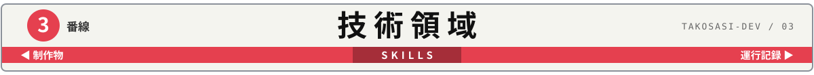
<picture><source media="(max-width: 600px)" srcset="assets/routemap-m.svg">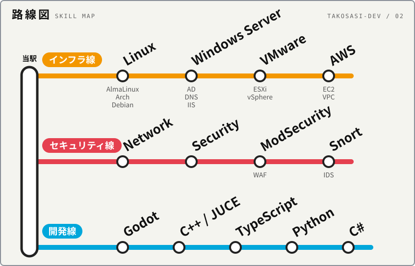</picture>

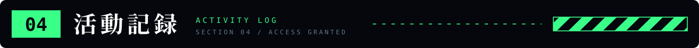
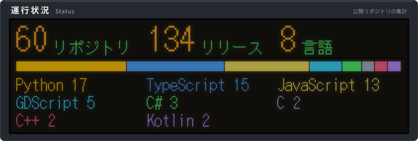
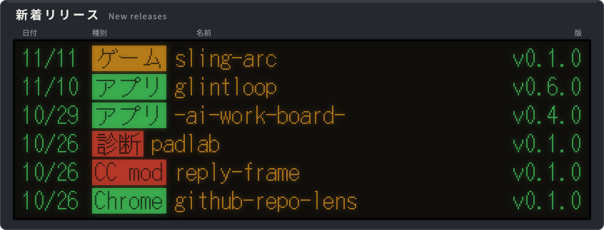
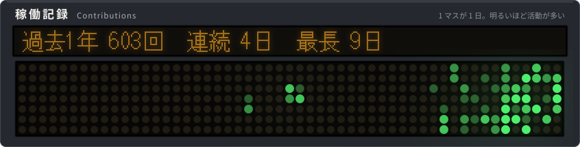
<picture><source media="(max-width: 600px)" srcset="assets/timetable-m.svg">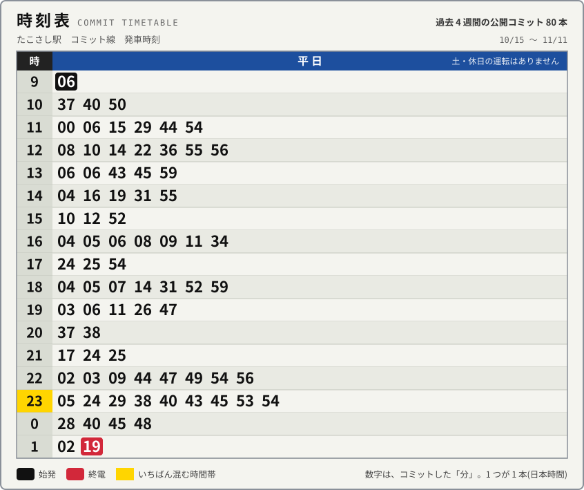</picture>
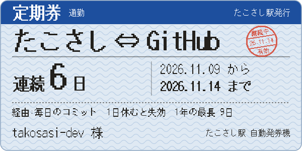
<picture><source media="(max-width: 600px)" srcset="assets/stamps-m.svg">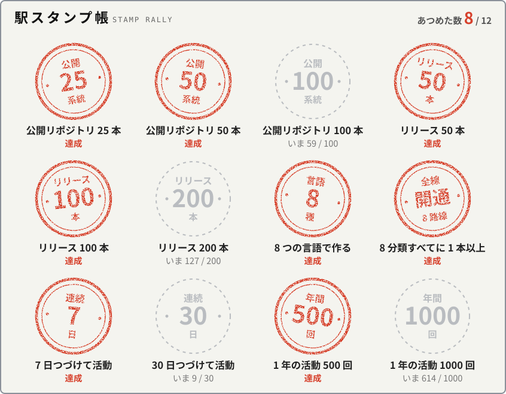</picture>
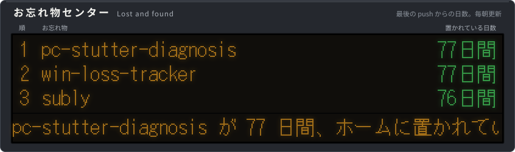
<picture><source media="(max-width: 600px)" srcset="assets/lost-delay-m.svg">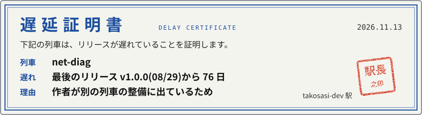</picture>
<picture><source media="(max-width: 600px)" srcset="assets/history-m.svg">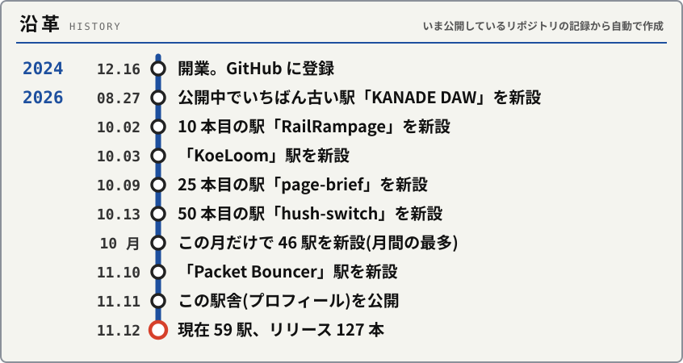</picture>

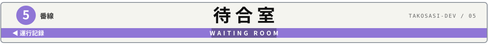

列車を待つあいだに遊べるミニゲームです。札を押すと開きます。答えは選択肢を押すと出ます。

改札の先(GitHub Pages)には、実時刻で動く発車標、発車ベル(押したときだけ鳴ります)、キーボードで遊べるゲームがあります。回ると印が増える「構内スタンプラリー」(6 つ)もあります。

<picture>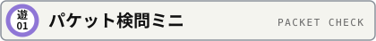</picture>

 

あなたはファイアウォールです。規則を上から順に見て、最初に合った行のとおりに、パケットを「通す」か「落とす」か決めてください。全 5 問。

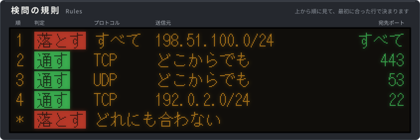

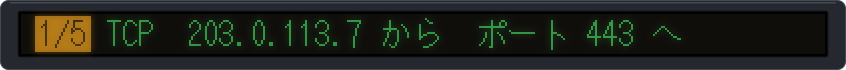

通す
<blockquote><b>正解。</b>規則 2(TCP の 443)に合います。</blockquote>

落とす
<blockquote><b>不正解。</b>規則 2(TCP の 443)に合うので、通します。</blockquote>

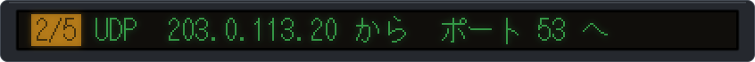

通す
<blockquote><b>正解。</b>規則 3(UDP の 53)に合います。</blockquote>

落とす
<blockquote><b>不正解。</b>規則 3(UDP の 53)に合うので、通します。</blockquote>

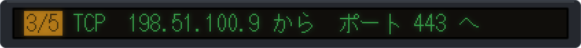

通す
<blockquote><b>不正解。</b>ポートは 443 ですが、その前に規則 1(198.51.100.0/24 からは全部落とす)に合います。先に合った行で決まります。</blockquote>

落とす
<blockquote><b>正解。</b>規則 2 より先に、規則 1(198.51.100.0/24 からは全部落とす)に合います。</blockquote>

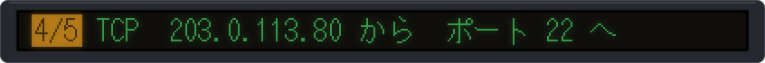

通す
<blockquote><b>不正解。</b>ポート 22 を通すのは 192.0.2.0/24 からだけです(規則 4)。どの行にも合わないので落とします。</blockquote>

落とす
<blockquote><b>正解。</b>規則 4 は送信元が 192.0.2.0/24 のときだけ。どの行にも合いません。</blockquote>

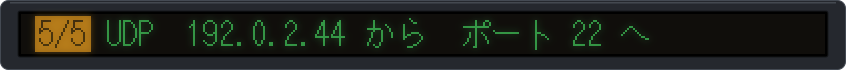

通す
<blockquote><b>不正解。</b>送信元とポートは規則 4 に合いますが、規則 4 は TCP だけです。UDP なのでどの行にも合わず、落とします。</blockquote>

落とす
<blockquote><b>正解。</b>規則 4 は TCP だけ。UDP はどの行にも合いません。</blockquote>

続きは本編でどうぞ。

<picture>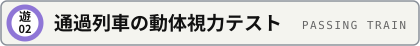</picture>

 

LED の板を、列車の案内が一瞬で通過します。4 けたの列車番号を読み取ってください。5 秒ごとに何度でも通過します。 
(OS で「動きを減らす」設定にしていると、文字は止まって表示されます)

<b>レベル 1</b>

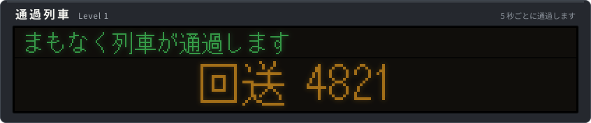

4281
<blockquote><b>不正解。</b>もう一度見てみてください。</blockquote>

4821
<blockquote><b>正解。</b>回送 4821 でした。</blockquote>

4827
<blockquote><b>不正解。</b>もう一度見てみてください。</blockquote>

<b>レベル 2</b>

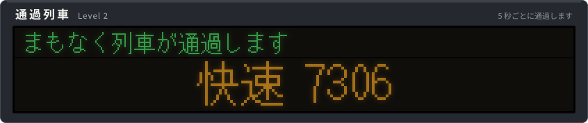

7306
<blockquote><b>正解。</b>快速 7306 でした。</blockquote>

7360
<blockquote><b>不正解。</b>もう一度見てみてください。</blockquote>

7036
<blockquote><b>不正解。</b>もう一度見てみてください。</blockquote>

<b>レベル 3</b>

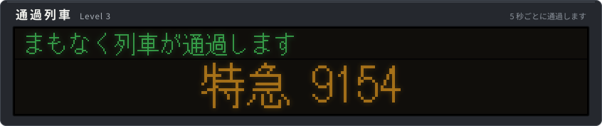

9145
<blockquote><b>不正解。</b>もう一度見てみてください。</blockquote>

9514
<blockquote><b>不正解。</b>もう一度見てみてください。</blockquote>

9154
<blockquote><b>正解。</b>特急 9154 でした。読めたらかなりの目です。</blockquote>

<picture>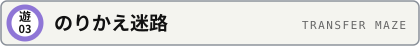</picture>

 

思いついたアイデアを、リリースまで運んでください。路線図を見て、乗る列車を選びます。3 回の乗車でリリース駅に着けばクリアです。

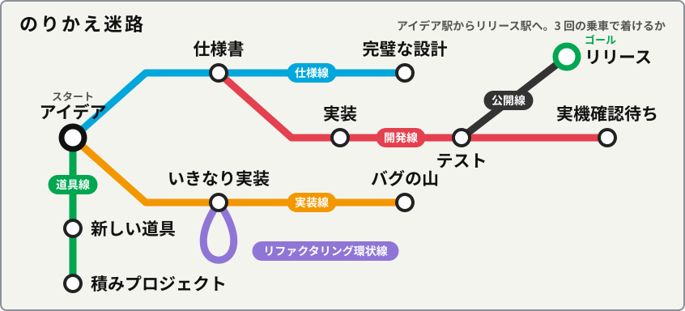

<b>アイデア駅。</b>どの列車に乗りますか。

青の仕様線に乗る

<blockquote>

<b>仕様書駅に着きました。</b>何を作るかが紙になりました。次はどうしますか。

赤の開発線に乗りかえる

<blockquote>

実装駅を通って、<b>テスト駅に着きました。</b>動く物ができています。次はどうしますか。

黒の公開線に乗りかえる

<blockquote>

<b>リリース駅に到着。クリアです。</b>3 回の乗車、最短でした。本日もご利用ありがとうございました。

</blockquote>

このまま開発線で終点まで乗る

<blockquote>

<b>終点、実機確認待ち駅。</b>ホームには誰もいません。確認してくれる人を、ずっと待つことになりました。テスト駅で乗りかえるべきでした。

線路を歩いて先へ進む

<blockquote>

トンネルを 1 つ抜けると、<b>路線図に載っていない駅</b>に出ました。駅名標には「きさらぎ」とあります。時刻表は白紙で、発車標には「次の列車 未定」とだけ出ています。遠くで太鼓と鈴の音がしますが、気のせいでしょう。隠し駅を見つけたあなたは、きっと README のソースまで読む人です。来た線路を戻れば、テスト駅に帰れます。

</blockquote>

</blockquote>

</blockquote>

このまま仕様線で終点まで乗る

<blockquote>

<b>終点、完璧な設計駅。</b>設計書は 300 ページになりましたが、コードはまだ 1 行もありません。仕様書駅で乗りかえるべきでした。

</blockquote>

</blockquote>

橙の実装線に乗る

<blockquote>

<b>いきなり実装駅に着きました。</b>何を作るか決めないまま、もう書き始めています。次はどうしますか。

紫のリファクタリング環状線に乗りかえる

<blockquote>

ぐるっと一周して、<b>いきなり実装駅に戻ってきました。</b>コードはきれいになりましたが、1 駅も進んでいません。アイデア駅からやり直しです。

</blockquote>

このまま実装線で終点まで乗る

<blockquote>

<b>終点、バグの山駅。</b>この先に線路はありません。アイデア駅からやり直しです。

</blockquote>

</blockquote>

緑の道具線に乗る

<blockquote>

新しい道具駅で道具を選んでいるうちに、<b>終点、積みプロジェクト駅</b>に着きました。道具はそろいましたが、何も作っていません。アイデア駅からやり直しです。

</blockquote>

<picture></picture>

 

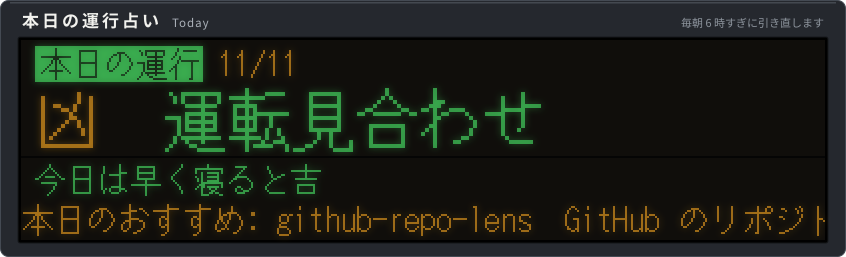

<!-- FORTUNE:START -->
本日のおすすめ: <a href="https://github.com/takosasi-dev/spec-lint">spec-lint</a>（開いている仕様ノートを、ルールノートの決まりと照らして点検する）
<!-- FORTUNE:END -->

<picture>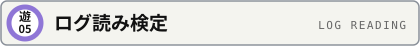</picture>

 

Web サーバのアクセスログです。6 行のうち、攻撃の行を当ててください。全 5 問、毎回ちがう種類の攻撃です。 
(読みやすいように、一部の記号は元の形で表示しています。送信元は文書用の番号で、実在しません)

<!-- LOGQUIZ:START -->
<b>第 1 問</b>

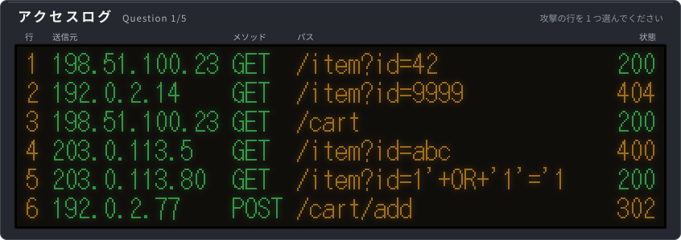

2 行目
<blockquote><b>不正解。</b>無い商品番号を開いて 404 になっただけです。攻撃の記号はありません。</blockquote>

4 行目
<blockquote><b>不正解。</b>数字のはずの所に abc を入れて 400。入力まちがいの範囲です。引用符や OR はありません。</blockquote>

5 行目
<blockquote><b>正解。</b>SQL インジェクションです。番号が入るはずの id に、引用符と OR '1'='1(いつでも成り立つ条件)が入っています。</blockquote>

<b>第 2 問</b>

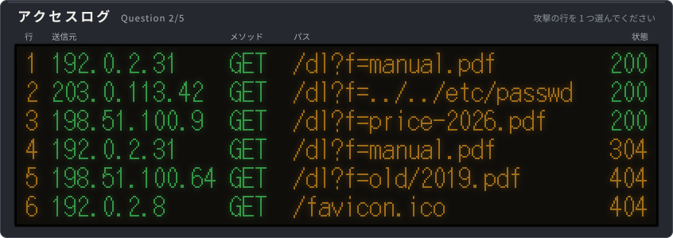

2 行目
<blockquote><b>正解。</b>パスのさかのぼり(ディレクトリトラバーサル)です。ファイル名に ../ を重ねて、公開フォルダの外にある /etc/passwd を読もうとしています。</blockquote>

4 行目
<blockquote><b>不正解。</b>304 は「前に渡した物から変わっていない」の返事。ふつうの再読み込みです。</blockquote>

5 行目
<blockquote><b>不正解。</b>フォルダの区切り / はありますが、../ で上にはさかのぼっていません。古いファイルが無くて 404 になっただけです。</blockquote>

<b>第 3 問</b>

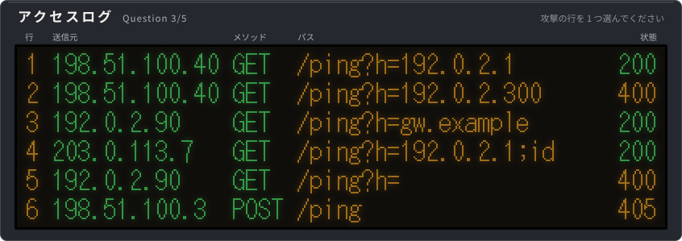

2 行目
<blockquote><b>不正解。</b>300 は IP アドレスに無い数字。打ちまちがいで 400 になっただけです。</blockquote>

4 行目
<blockquote><b>正解。</b>コマンド注入です。ホスト名の後ろに ; を付けて、別のコマンド(id)を続けて走らせようとしています。</blockquote>

6 行目
<blockquote><b>不正解。</b>この URL では POST が許されておらず 405。; や | のような記号はありません。</blockquote>

<b>第 4 問</b>

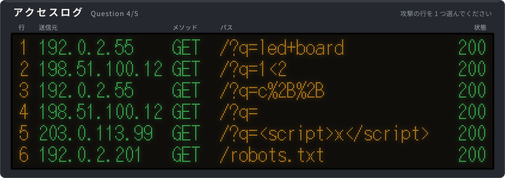

2 行目
<blockquote><b>不正解。</b>&lt; はありますが、タグの形になっていません。「1&lt;2」を調べただけです。</blockquote>

3 行目
<blockquote><b>不正解。</b>%2B は + を URL 用に書き換えた物。「c++」を調べただけです。</blockquote>

5 行目
<blockquote><b>正解。</b>クロスサイトスクリプティング(XSS)です。検索語に &lt;script&gt; タグを入れ、ページにそのまま出力されてスクリプトが動くかを試しています。</blockquote>

<b>第 5 問</b>

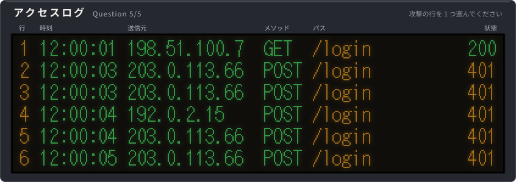

1 行目
<blockquote><b>不正解。</b>ログイン画面を開いただけ(GET で 200)です。</blockquote>

3 行目
<blockquote><b>正解。</b>総当たり(ブルートフォース)です。同じ 203.0.113.66 が、2 秒のあいだに 4 回続けてログインに失敗しています。人の手では打てない速さです。</blockquote>

4 行目
<blockquote><b>不正解。</b>別の送信元の、1 回だけの失敗です。パスワードの打ちまちがいでしょう。</blockquote>

<!-- LOGQUIZ:END -->

<picture></picture>

 

毎朝 1 問、入れ替わります。答えだと思う物を押してください。

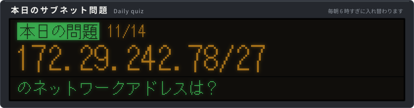

<!-- SUBNET:START -->

172.19.0.0
<blockquote><b>不正解。</b>それは /16 のときの答えです。/20 はもっと細かく区切ります。</blockquote>

172.19.208.0
<blockquote><b>不正解。</b>それは 1 つ後ろの区切りの先頭です。</blockquote>

172.19.192.0
<blockquote><b>正解。</b>/20 は、3 番目の数字を 16 ずつに区切ります。197 は 192〜207 の区切りに入るので、ネットワークアドレスは 172.19.192.0、ブロードキャストアドレスは 172.19.207.255。アドレスは全部で 4,096 個、使えるホストはそこから 2 を引いて 4,094 台です。</blockquote>

<!-- SUBNET:END -->

<picture>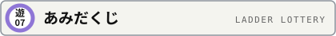</picture>

 

毎朝引き直します。1〜4 番のりばから 1 つ選んで、線を下へたどってください。横線に当たったら必ず曲がります。着いた先(A〜D)が、あなたへの本日のおすすめです。

たどり終わったら、選んだのりばを押して答え合わせをどうぞ。

<!-- AMIDA:START -->

1 番のりば
<blockquote><b>B</b> に着きます。本日のおすすめは <a href="https://github.com/takosasi-dev/koe-loom">koe-loom</a>(Discord などで使える Windows 11 向けボイスチェンジャー（DSP のみ、JUCE / C++）。プレリリース)。</blockquote>

2 番のりば
<blockquote><b>C</b> に着きます。本日のおすすめは <a href="https://github.com/takosasi-dev/handoff-board">handoff-board</a>(引き継ぎノートを古い順にサイドバーへ並べる)。</blockquote>

3 番のりば
<blockquote><b>D</b> に着きます。本日のおすすめは <a href="https://github.com/takosasi-dev/delve-down">delve-down</a>(ターミナルで遊ぶ、文字で描くダンジョンのローグライク(Python 標準ライブラリだけ))。</blockquote>

4 番のりば
<blockquote><b>A</b> に着きます。本日のおすすめは <a href="https://github.com/takosasi-dev/spec-lint">spec-lint</a>(開いている仕様ノートを、ルールノートの決まりと照らして点検する)。</blockquote>

<!-- AMIDA:END -->

<picture></picture>

 

そっくりな発車標が 2 枚あります。違う所は 5 か所。全部見つけてください。

答えを見る

 

<blockquote>1 行目の時刻(06:17 と 06:11)、2 行目の種別の色(緑と橙)、5 行目ののりば(2 と 3)、6 行目の行先(完璧と完壁)、一番下の案内(内側と外側)の 5 か所です。</blockquote>

<!-- お忘れ物のお問い合わせは、お忘れ物取扱所 docs/lost-and-found.md まで。 -->

<picture></picture>

 

見に来た人みんなで 1 本の列車を動かす、環状線のすごろくです。下の札を押し、開いた画面でそのまま緑のボタンを押すと、列車がその数だけ進みます(GitHub へのログインが要ります)。同じ人が続けて 2 回は運転できません。運転した人の GitHub の名前が、運転記録の板に載ります。

<picture><source media="(max-width: 600px)" srcset="assets/train-m.svg"></picture>

Issue は自動で返事が付いて閉じられます。絵が変わるまで数分かかることがあります。

<picture></picture>

 

たこさし駅から、あなたの GitHub アカウントまでの記念乗車券を発行します。下の札を押し、開いた画面でそのまま緑のボタンを押してください(GitHub へのログインが要ります)。あなたの名前と通し番号が入ったきっぷの画像が、Issue の返事で届きます。自分の README に貼る 1 行も付いてきます。

Issue は自動で返事が付いて閉じられます。同じ人が何度出しても、番号は最初の 1 枚と同じです。

<picture></picture>

 

駅の伝言板です。下の札から一言を選んで押し、開いた画面でそのまま緑のボタンを押すと、その一言があなたの GitHub の名前と一緒に板に書かれます(GitHub へのログインが要ります)。書けるのは札の 8 つの文だけで、1 人 1 行です。もう一度書くと、前の行と入れ替わります。

Issue は自動で返事が付いて閉じられます。絵が変わるまで数分かかることがあります。

<a href="https://github.com/takosasi-dev/takosasi-dev">このリポジトリ</a>にスターを付けると、数分であなたのアイコンが列車の窓に載ります。

<a href="ABOUT.md">この駅のしくみ</a>(どう作って、どう動かしているか)

